<div class="vp-doc" style="max-width:960px;margin:0 auto;padding:24px;">

<div class="welink-badges">
  <a href="https://github.com/runzhliu/welink/stargazers"></a>
  <a href="https://github.com/runzhliu/welink/releases"></a>
  <a href="https://github.com/runzhliu/welink/blob/main/LICENSE"></a>
  
  
</div>

<section class="welink-sft-spotlight" aria-labelledby="welink-sft-title">
  <div class="welink-sft-intro">
    <span class="welink-sft-badge">v0.4.0 · 模型训练</span>
    <h2 id="welink-sft-title">让模型学会你的表达方式</h2>
    <p>从自己愿意使用的聊天记录出发，准备样本、微调小模型、比较效果，再接入 WeLink 试聊。训练过程和产物由你选择的环境管理。</p>
    <a class="welink-sft-link" href="/sft">了解 SFT 工作台 <span aria-hidden="true">→</span></a>
  </div>
  <div class="welink-sft-journey" aria-label="SFT 训练流程">
    <div><span>01</span><strong>准备与审核</strong><small>选择范围 · 冻结数据</small></div>
    <div><span>02</span><strong>连接训练机</strong><small>Apple Silicon · NVIDIA GPU</small></div>
    <div><span>03</span><strong>预检与训练</strong><small>LoRA · 任务与指标</small></div>
    <div><span>04</span><strong>对比与试用</strong><small>盲评 · 导出 · 接入</small></div>
  </div>
  <p class="welink-sft-footnote">v0.4.0 已发布，完整硬件验收仍在进行。训练数据会发送到你选择的训练机；模型也可能记住聊天内容，请谨慎保存与分享。</p>
</section>

<div class="welink-stats">
  <div class="welink-stat-card">
    <div class="stat-icon">🛠️</div>
    <div class="num"><span class="welink-countup" data-to="20" data-dur="1500">0</span></div>
    <div class="lbl">MCP 工具</div>
  </div>
  <div class="welink-stat-card">
    <div class="stat-icon">📦</div>
    <div class="num"><span class="welink-countup" data-to="8" data-dur="1200">0</span></div>
    <div class="lbl">导出目标</div>
  </div>
  <div class="welink-stat-card">
    <div class="stat-icon">🧩</div>
    <div class="num"><span class="welink-countup" data-to="25" data-dur="1400">0</span><span class="stat-suffix">+</span></div>
    <div class="lbl">LLM 提供商</div>
  </div>
  <div class="welink-stat-card">
    <div class="stat-icon">🔒</div>
    <div class="num stat-text">本地优先</div>
    <div class="lbl">部署方式自主选择</div>
  </div>
</div>

## 为什么选 WeLink

<div class="welink-pillars">
  <div class="pillar">
    <div class="pillar-icon">
      <svg width="28" height="28" viewBox="0 0 24 24" fill="none" stroke="currentColor" stroke-width="1.75" stroke-linecap="round" stroke-linejoin="round"><path d="M12 22s8-4 8-10V5l-8-3-8 3v7c0 6 8 10 8 10z"/><path d="m9 12 2 2 4-4"/></svg>
    </div>
    <div class="pillar-title">本地优先，由你选择</div>
    <div class="pillar-body">聊天数据库与索引由你管理，可选择本地模型。使用远程训练机或云端服务时，相关数据会发送到你选择的环境。</div>
  </div>
  <div class="pillar">
    <div class="pillar-icon">
      <svg width="28" height="28" viewBox="0 0 24 24" fill="none" stroke="currentColor" stroke-width="1.75" stroke-linecap="round" stroke-linejoin="round"><path d="M21 15a2 2 0 0 1-2 2H7l-4 4V5a2 2 0 0 1 2-2h14a2 2 0 0 1 2 2z"/><path d="M8 10h.01"/><path d="M12 10h.01"/><path d="M16 10h.01"/></svg>
    </div>
    <div class="pillar-title">AI 读懂关系</div>
    <div class="pillar-body">不是搜索框 —— AI 分身模拟 TA 说话，关系预测提前预警降温，4 种调性破冰话术一键生成，还能让 AI 写双人对话播客。</div>
  </div>
  <div class="pillar">
    <div class="pillar-icon">
      <svg width="28" height="28" viewBox="0 0 24 24" fill="none" stroke="currentColor" stroke-width="1.75" stroke-linecap="round" stroke-linejoin="round"><path d="M19.439 7.85c-.049.322.059.648.289.878l1.568 1.568c.47.47.706 1.087.706 1.704s-.235 1.233-.706 1.704l-1.611 1.611a.98.98 0 0 1-.837.276c-.47-.07-.802-.48-.968-.925a2.501 2.501 0 1 0-3.214 3.214c.446.166.855.497.925.968a.98.98 0 0 1-.276.837l-1.61 1.61a2.404 2.404 0 0 1-1.705.707 2.402 2.402 0 0 1-1.704-.706l-1.568-1.568a1.026 1.026 0 0 0-.877-.29c-.493.074-.84.504-1.02.968a2.5 2.5 0 1 1-3.237-3.237c.464-.18.894-.527.967-1.02a1.026 1.026 0 0 0-.289-.877l-1.568-1.568A2.402 2.402 0 0 1 1.998 12c0-.617.236-1.234.706-1.704L4.23 8.77c.24-.24.581-.353.917-.303.515.077.877.528 1.073 1.01a2.5 2.5 0 1 0 3.259-3.259c-.482-.196-.933-.558-1.01-1.073-.05-.336.062-.676.303-.917l1.525-1.525A2.402 2.402 0 0 1 12 1.998c.617 0 1.234.236 1.704.706l1.568 1.568c.23.23.556.338.877.29.493-.074.84-.504 1.02-.968a2.5 2.5 0 1 1 3.237 3.237c-.464.18-.894.527-.967 1.02z"/></svg>
    </div>
    <div class="pillar-title">25+ 种 LLM 任选</div>
    <div class="pillar-body">DeepSeek / 豆包 / Kimi / OpenAI / Claude / Gemini / Ollama / Vertex / Bedrock / OpenRouter / SiliconFlow / Azure …… 原生支持，多配置热切换，哪家便宜用哪家。</div>
  </div>
</div>

## 与 DSH 一起使用

WeLink DSH 插件让 DeepSeek Harness（包括独立的 Super Agent 容器）通过只读工具查询你授权的聊天记录。你可以让 Agent 查找某天的私聊或群聊，或按关键词检索，再整理成摘要、待办与待确认事项。

插件默认不授权任何会话，聊天原文访问也默认关闭；连接时需要配置会话范围和独立的只读令牌。DSH 可能保存查询结果，使用远程模型时内容也会发送给所选服务，请按自己的部署环境管理数据。

<div class="welink-dsh-demo">
  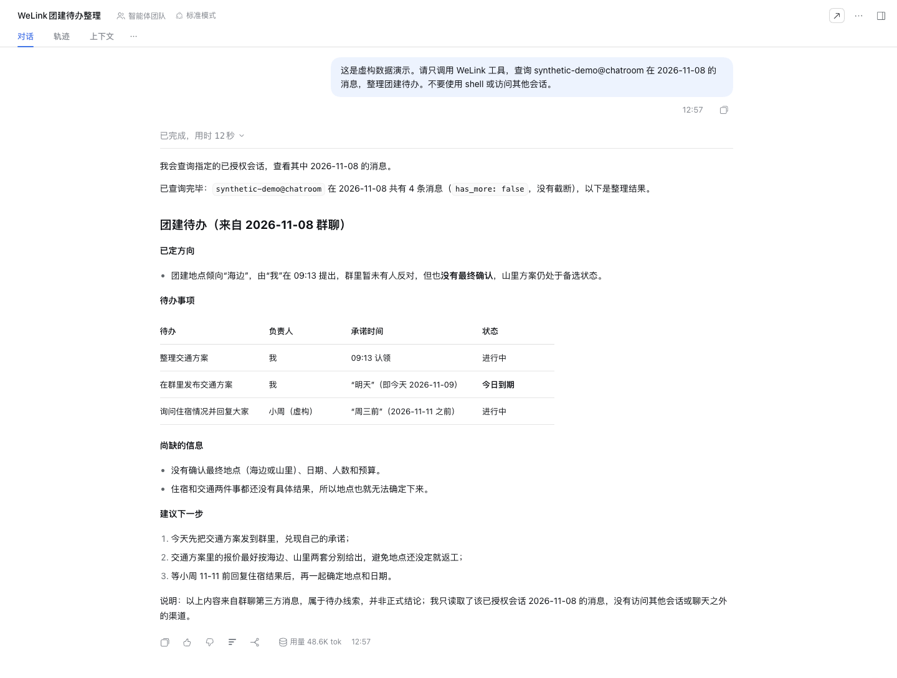
  <p>演示使用虚构群聊数据：查询指定日期的消息，整理待办、负责人和待确认事项。</p>
</div>

[查看 DSH 插件与安装指南 →](https://github.com/runzhliu/welink/tree/main/plugins/dsh-welink) · 插件随源码提供，需使用包含 Agent 查询接口的 WeLink 后端。

## 新版界面预览

以下浅色界面预览由操作前后的页面截图组成，使用内置的虚构演示数据；AI 回复为演示模式的预置内容。

<div class="welink-video-hero">
  <div class="welink-video-card">
    <div class="welink-video-card-label">AI 分身</div>
    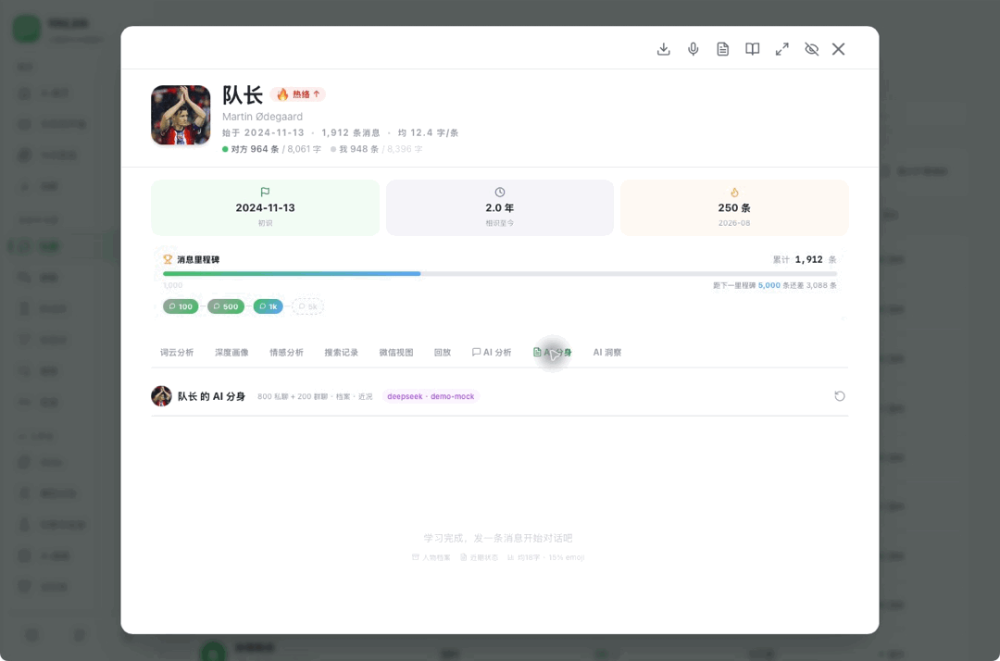
  </div>
  <div class="welink-video-card">
    <div class="welink-video-card-label">AI 分析</div>
    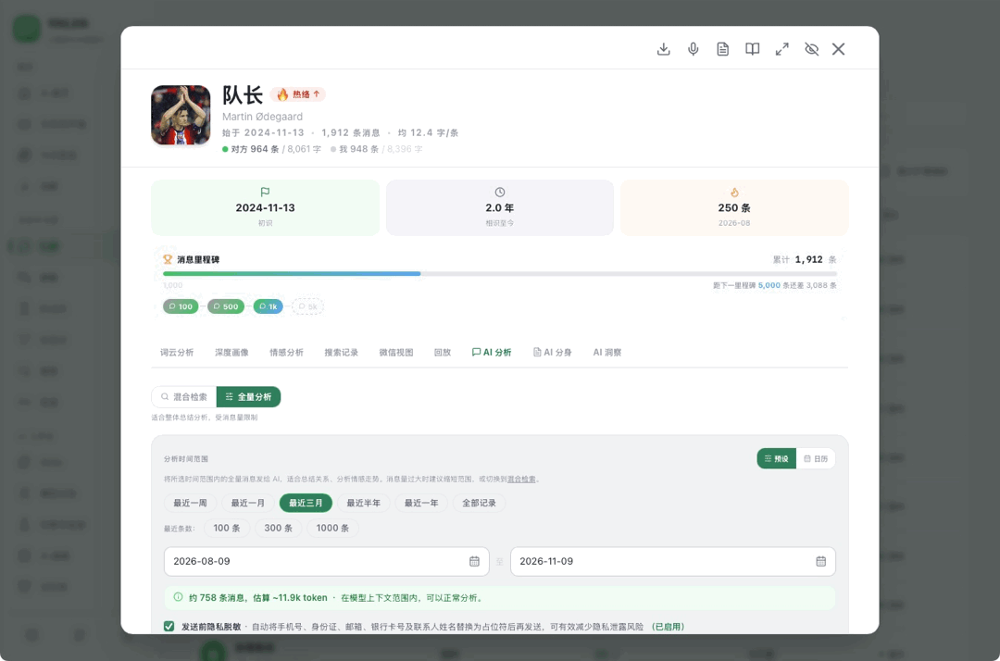
  </div>
  <div class="welink-video-card">
    <div class="welink-video-card-label">AI 群聊配置</div>
    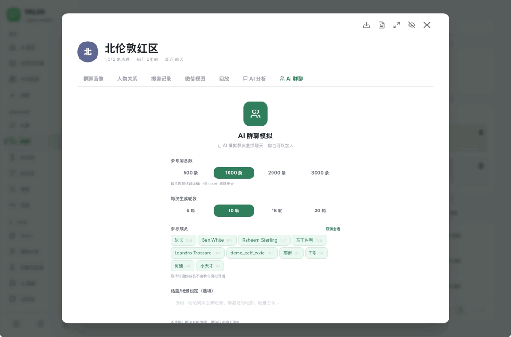
  </div>
  <div class="welink-video-card">
    <div class="welink-video-card-label">AI 首页</div>
    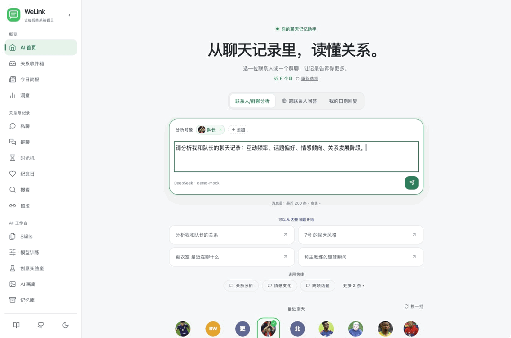
  </div>
  <div class="welink-video-card">
    <div class="welink-video-card-label">快速入门引导</div>
    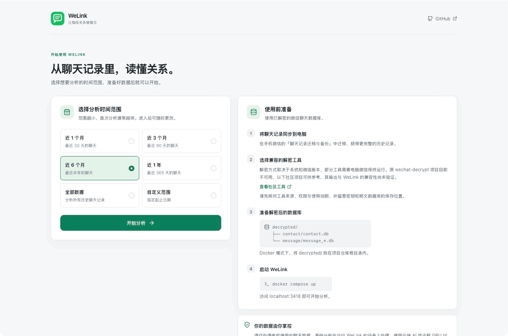
  </div>
  <div class="welink-video-card">
    <div class="welink-video-card-label">好友总览</div>
    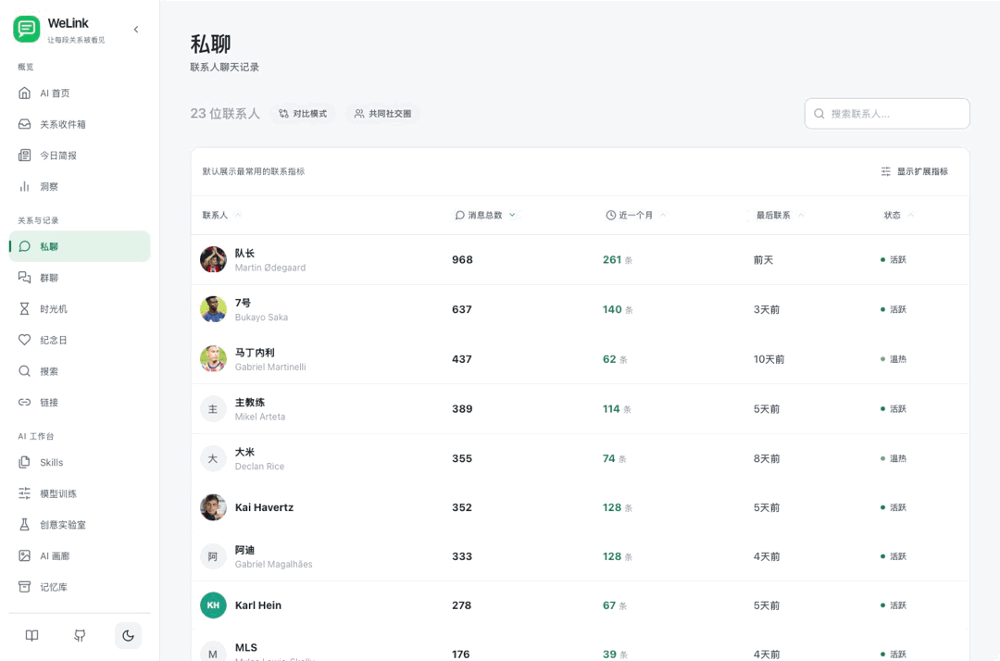
  </div>
  <div class="welink-video-card">
    <div class="welink-video-card-label">好友深度画像</div>
    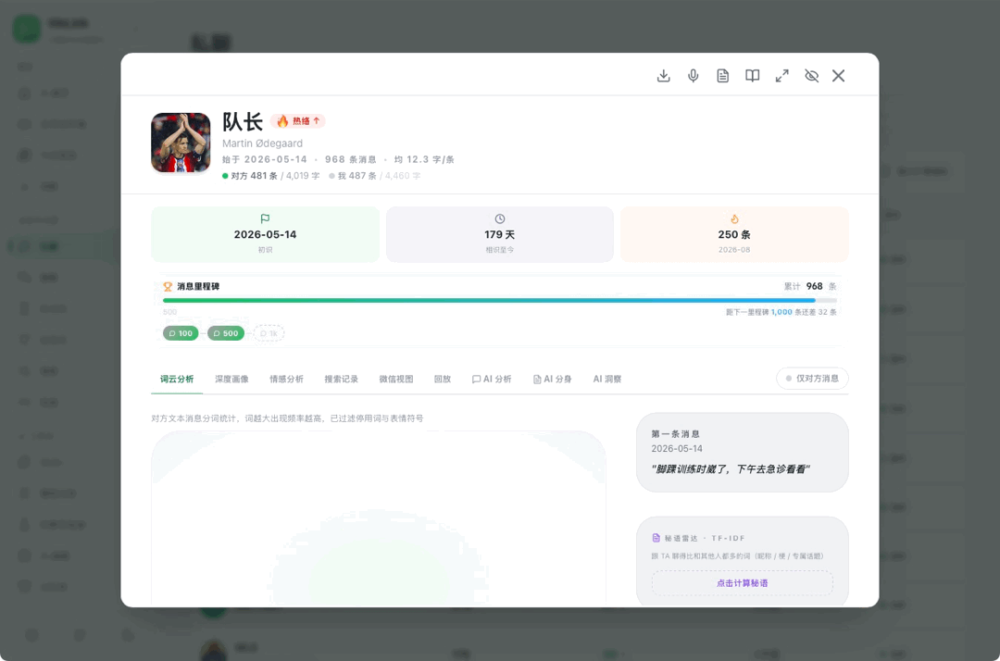
  </div>
  <div class="welink-video-card">
    <div class="welink-video-card-label">群聊画像</div>
    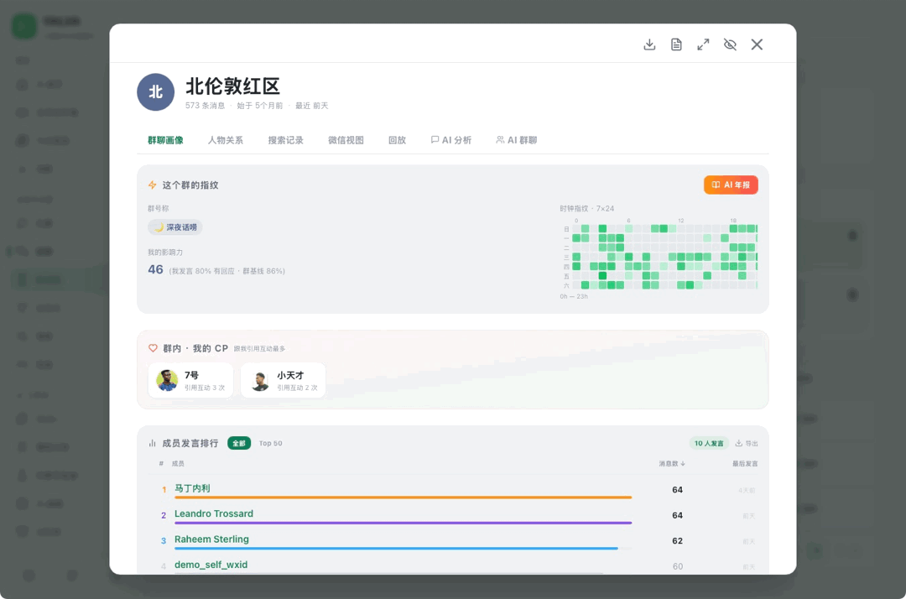
  </div>
  <div class="welink-video-card">
    <div class="welink-video-card-label">全局搜索</div>
    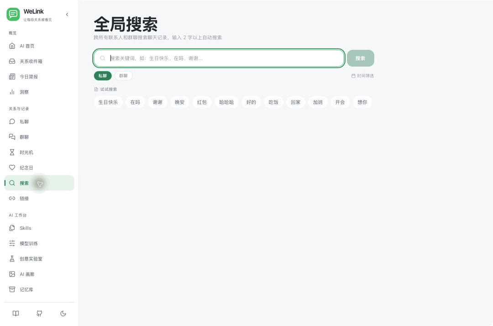
  </div>
  <div class="welink-video-card">
    <div class="welink-video-card-label">时间线</div>
    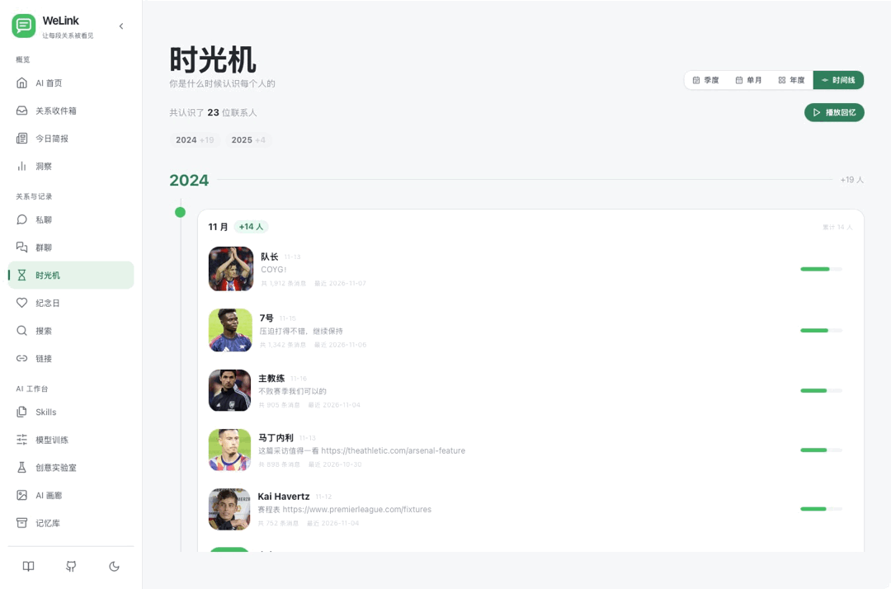
  </div>
  <div class="welink-video-card">
    <div class="welink-video-card-label">时光机</div>
    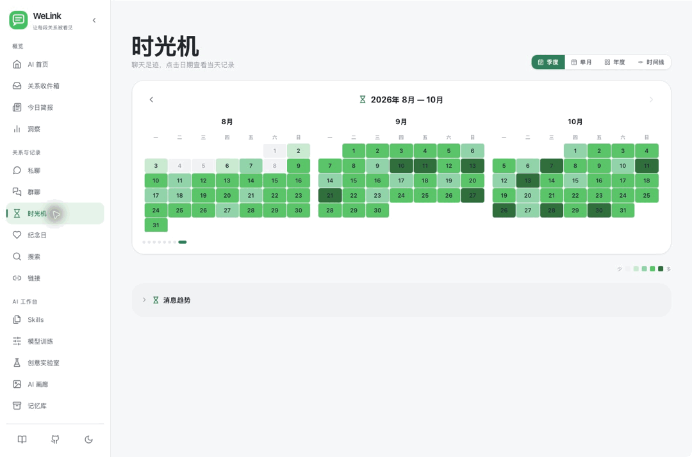
  </div>
  <div class="welink-video-card">
    <div class="welink-video-card-label">纪念日</div>
    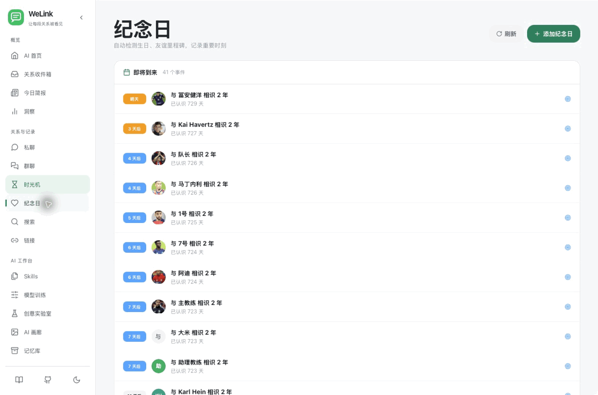
  </div>
  <div class="welink-video-card">
    <div class="welink-video-card-label">私聊微信视图</div>
    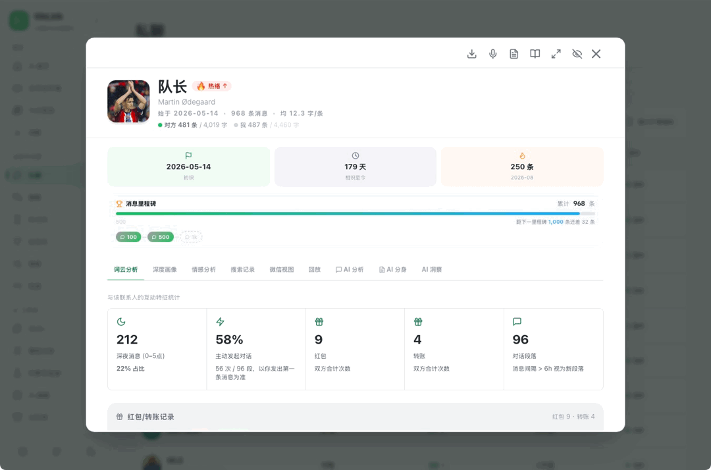
  </div>
  <div class="welink-video-card">
    <div class="welink-video-card-label">SFT 工作台</div>
    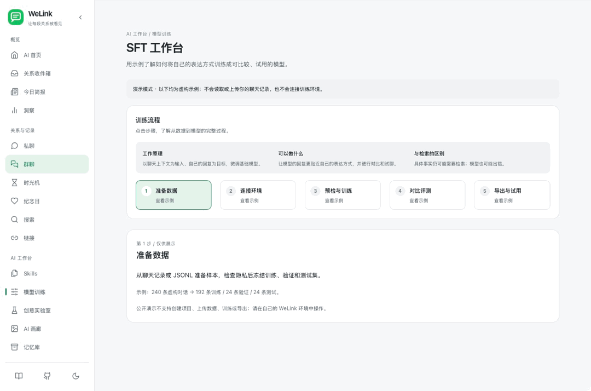
  </div>
</div>

<p class="welink-all-features-cta">
  <a href="/features">📚 查看全部功能清单 →</a>
</p>

## 🎮 试一下（无需安装）

不想下载也能试 —— 我们托管了一个带阿森纳 2025/26 球员示例数据的 Demo 站点：

<div class="welink-demo-embed">
  <div class="iframe-wrap">
    <iframe
      src="https://demo.welink.click"
      title="WeLink 在线 Demo"
      loading="lazy"
      referrerpolicy="no-referrer-when-downgrade"
    ></iframe>
  </div>
  <div class="footer">
    <span>🏴󠁧󠁢󠁥󠁮󠁧󠁿 <b>COYG!</b> · Demo 数据：阿森纳 2025/26 一线队与教练组聊天记录</span>
    <a href="https://demo.welink.click" target="_blank">在新窗口打开 →</a>
  </div>
</div>

## 快速开始

### Demo 模式（无需真实数据）

```bash
cd welink
docker compose -f docker-compose.demo.yml up
```

访问 [localhost:3418](http://localhost:3418) 即可体验，预置了完整联系人列表与模拟消息。

### 正式使用

**第一步** — 获取解密后的微信数据库。原解密项目目前不可用；替代工具及兼容性提示见 [安装指南](./install#解密微信数据库)。

**第二步** — 启动 WeLink：

::: code-group

```bash [Docker]
cd welink
docker compose up
```

```bash [macOS App]
# 从 GitHub Releases 下载 WeLink.dmg
# 启动后在配置向导中选择 decrypted/ 目录
```

```bash [Windows App]
# 从 GitHub Releases 下载 WeLink-windows-amd64.zip
# 解压后双击 WeLink.exe
```

:::

访问 [localhost:3418](http://localhost:3418) 开始分析。

<div class="welink-marquee" aria-hidden="true">
  <div class="welink-marquee-track">
    <span>本地优先</span>
    <span>SFT 工作台 · v0.4.0 预览</span>
    <span>AI 分身</span>
    <span>AI 虚拟群聊</span>
    <span>互动小说</span>
    <span>关系动态预测</span>
    <span>每日社交简报</span>
    <span>断联预警</span>
    <span>AI 文生图</span>
    <span>群聊时钟指纹</span>
    <span>AI 群年报</span>
    <span>自然语言查数据</span>
    <span>导出到 8 种目标</span>
    <span>Skill 炼化 × LoRA</span>
    <span>MCP × Claude Code</span>
    <!-- 复制一份保证无缝循环 -->
    <span>本地优先</span>
    <span>SFT 工作台 · v0.4.0 预览</span>
    <span>AI 分身</span>
    <span>AI 虚拟群聊</span>
    <span>互动小说</span>
    <span>关系动态预测</span>
    <span>每日社交简报</span>
    <span>断联预警</span>
    <span>AI 文生图</span>
    <span>群聊时钟指纹</span>
    <span>AI 群年报</span>
    <span>自然语言查数据</span>
    <span>导出到 8 种目标</span>
    <span>Skill 炼化 × LoRA</span>
    <span>MCP × Claude Code</span>
  </div>
</div>

</div>
